# 網站說明 — Threads 貼文分析 Dashboard

這份文件用截圖逐頁說明這個網站**實際長什麼樣子、每一頁在做什麼**，
不需要安裝或登入就能看完整個產品。

- **線上版**：https://threads-analytics-pi-sable.vercel.app （需登入）
- **原始碼**：https://github.com/juliahahah/threads-analytics
- **分析對象**：Threads 帳號 `@emoless_com`，16 則真實貼文（2026-09-28 ~ 10-01）

> 截圖取自本機示範模式（`DATA_SOURCE=mock`），資料與線上版同源，
> 皆讀自 `data/analysis.json`。

---

## 目錄

1. [首頁 — 說明資料管線](#1-首頁-說明資料管線)
2. [登入頁 — 兩種登入方式與權限控制](#2-登入頁-兩種登入方式與權限控制)
3. [Dashboard 總覽](#3-dashboard-總覽)
4. [總覽指標](#4-總覽指標)
5. [Top 5 貼文](#5-top-5-貼文)
6. [圖表區](#6-圖表區)
7. [文字長度與互動的關係](#7-文字長度與互動的關係)
8. [三組互動分層的 NLP 分析（第二題）](#8-三組互動分層的-nlp-分析第二題)
9. [分層結論：成功與失敗原因（第二題）](#9-分層結論成功與失敗原因第二題)
10. [常見關鍵字](#10-常見關鍵字)
11. [匯出](#11-匯出)

---

## 1. 首頁 — 說明資料管線

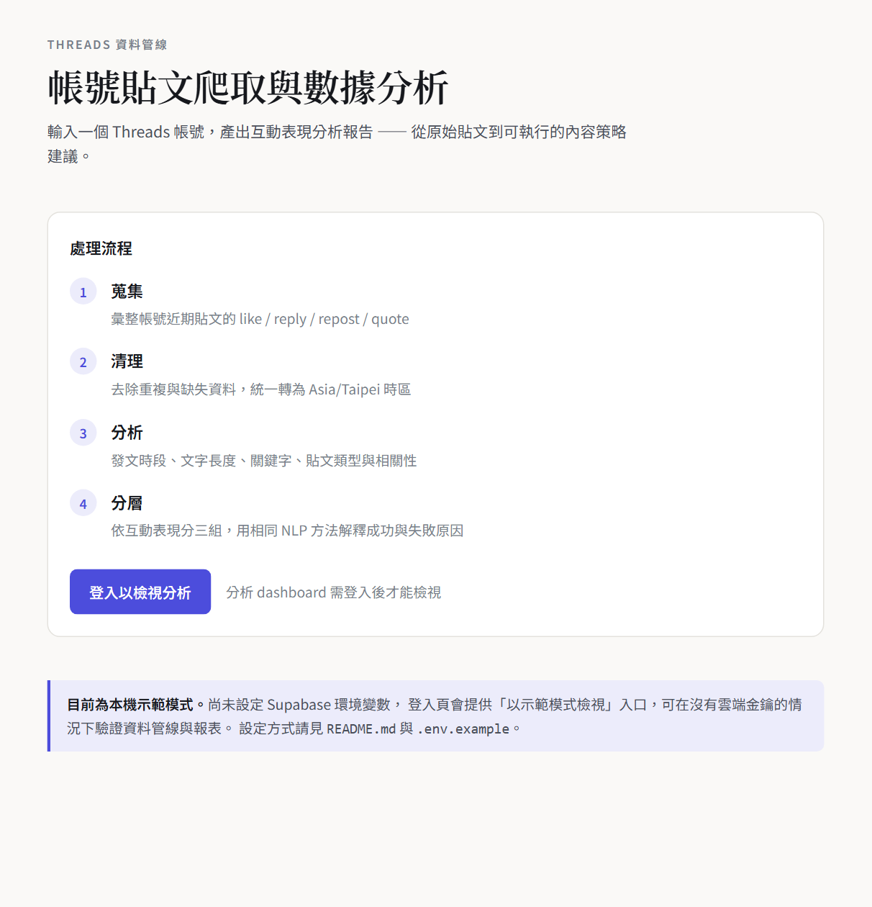

未登入時的入口頁。把四個處理階段寫在畫面上，讓看的人先知道資料怎麼來的：

| 階段 | 做什麼 |
| --- | --- |
| 1 蒐集 | 彙整帳號近期貼文的 like / reply / repost / quote |
| 2 清理 | 去除重複與缺失資料，統一轉為 Asia/Taipei 時區 |
| 3 分析 | 發文時段、文字長度、關鍵字、貼文類型與相關性 |
| 4 分層 | 依互動表現分三組，用相同 NLP 方法解釋成功與失敗原因 |

「登入以檢視分析」是唯一入口 —— **dashboard 不對未登入者開放**。

---

## 2. 登入頁 — 兩種登入方式與權限控制

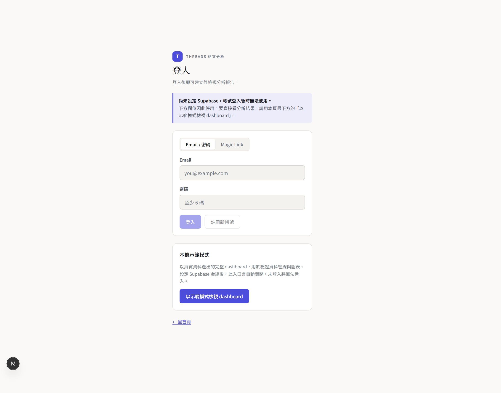

考題要求「至少支援 Email / Password 或 Magic Link 其中一種」，這裡**兩種都做了**，
以 tab 切換。

截圖中欄位呈現停用狀態，是因為本機示範模式沒有設定 Supabase 金鑰。
這裡有一個刻意的設計決定：

> **示範入口（`?demo=1`）只在 Supabase 未設定時才開啟。**
> 一旦設定了金鑰，這個入口自動關閉，未登入就無法進入 dashboard。

也就是說，示範模式**不能用來繞過正式登入**。實作見
[`src/app/dashboard/page.tsx`](../src/app/dashboard/page.tsx)：

```ts
if (configured) {
  const supabase = await createServerSupabase();
  const { data: { user } } = await supabase.auth.getUser();
  if (!user) redirect('/login?redirectedFrom=/dashboard');
} else if (!demo) {
  // 沒有 auth 後端又沒有明確的 demo flag：拒絕，而不是暴露
  redirect('/login?reason=not-configured');
}
```

權限控制採**雙層防護**：`middleware.ts` 擋路由，Server Component 內再查一次 session。
middleware 可能因設定錯誤被繞過，Server Component 不會。
資料層則由 Supabase RLS 把關，四張表的 policy 都以 `auth.uid() = user_id` 為條件。

---

## 3. Dashboard 總覽

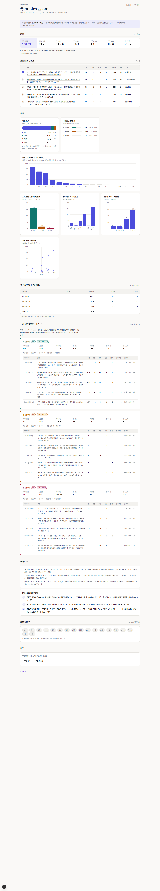

登入後的完整頁面，由上而下共 8 個區塊。以下逐區說明。

---

## 4. 總覽指標

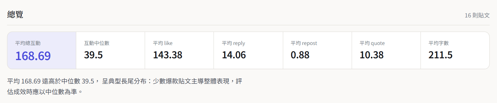

| 指標 | 數值 |
| --- | --- |
| 平均總互動 | **168.69** |
| 中位數總互動 | 39.5 |
| 平均 like | 143.38 |
| 平均 reply | 14.06 |
| 平均 repost | 0.88 |
| 平均 quote | 10.38 |
| 平均字數 | 211.5 |

**平均 168.69 但中位數只有 39.5** —— 這個落差本身就是一個發現：
少數幾則爆紅貼文把平均拉高，多數貼文的實際表現接近中位數。
因此後面的分析都以分層比較為主，而不是只看平均值。

頁首明示資料組成：16 則真實貼文 + 20 則合成資料，
而**所有分析指標只採計 16 則真實貼文**。

---

## 5. Top 5 貼文

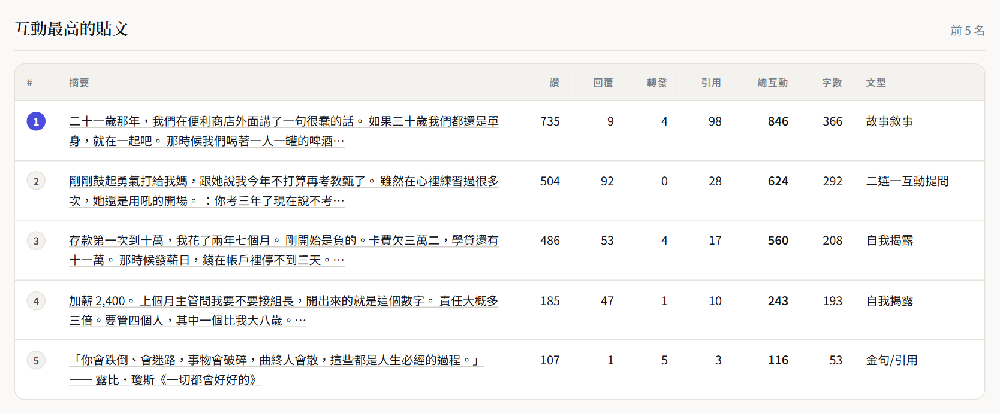

互動最高的前 5 篇，含完整的 like / reply / repost / quote 拆解、字數與貼文類型。
第一名總互動 846。

---

## 6. 圖表區

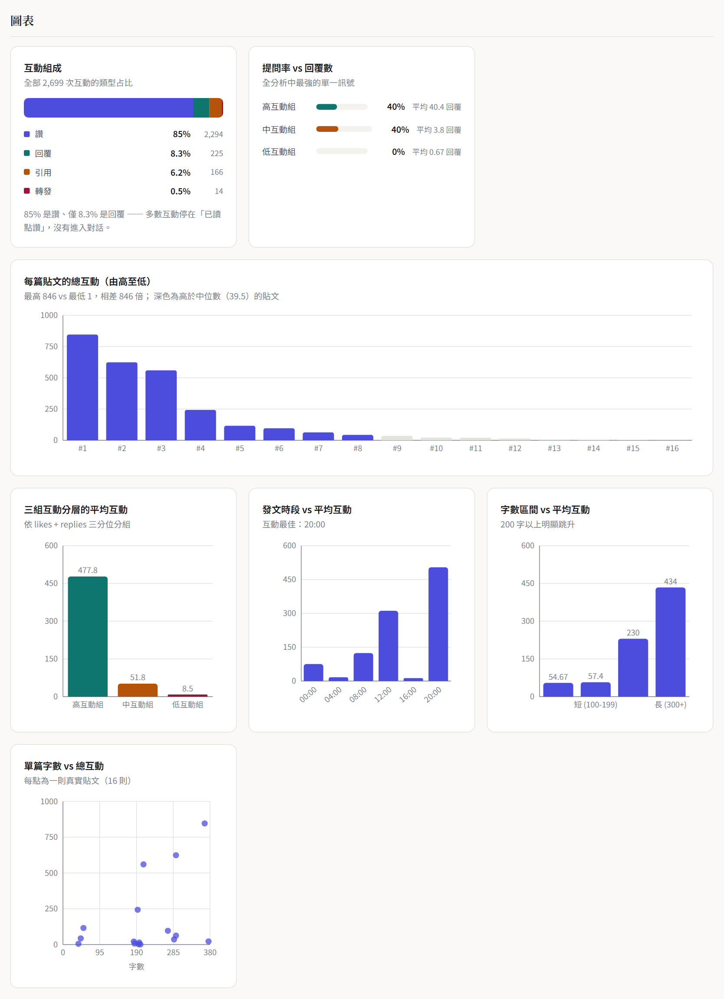

共 7 張圖（考題只要求 2 張）：

| 圖表 | 看什麼 |
| --- | --- |
| 互動組成 | like / reply / quote / repost 的占比 |
| 提問率 vs 回覆數 | 三組的提問率與平均回覆數並排 |
| 每篇貼文的總互動 | 由高至低排序，看長尾分布 |
| 三組互動分層的平均互動 | 高 / 中 / 低三組的差距 |
| 發文時段 vs 平均互動 | 幾點發文表現最好 |
| 字數區間 vs 平均互動 | 分組後的字數效果 |
| 單篇字數 vs 總互動 | 散點圖，看個別貼文的分布 |

圖表以 Recharts 繪製，與報告的 SVG 同源於 `data/analysis.json`。

---

## 7. 文字長度與互動的關係

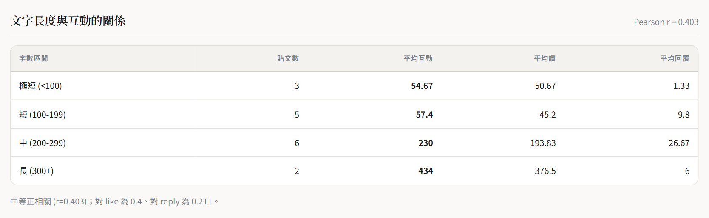

依字數分區間比較平均互動。表格同時列出每個區間的貼文數，
避免「某區間只有 1 則但平均很高」被誤讀為趨勢。

---

## 8. 三組互動分層的 NLP 分析（第二題）

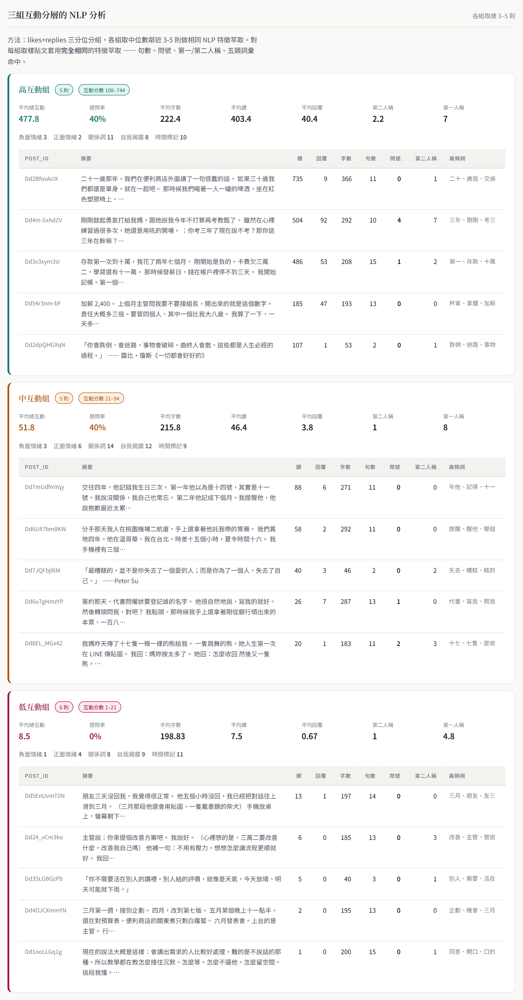

**這一區對應考題的「數據分析題（補充）」：**
依按讚與回覆分三組 → NLP 分析內文 → 解釋各組成功與失敗原因。

### 分組方法

以 `likes + replies` 排序後取**三分位**，切成高 / 中 / 低三組。
每組取**最接近該組中位數**的 3–5 則做樣本 —— 取中位數鄰近而非最高最低，
是為了讓樣本代表該組的典型特徵，而不是極端值。

| 組別 | 貼文數 | 取樣 | 互動分數範圍 |
| --- | --- | --- | --- |
| 高互動組 | 5 | 5 | 108–744 |
| 中互動組 | 5 | 5 | 21–94 |
| 低互動組 | 6 | 5 | 1–21 |

### NLP 特徵（三組套用**完全相同**的萃取流程）

實作於 [`scripts/analyze.py`](../scripts/analyze.py) 的 `nlp_profile()`：

1. 句數、平均句長（以 `。！？!?\n` 斷句）
2. 問號數、第一人稱「我」次數、第二人稱「你/妳」次數
3. 五類詞彙命中數：自我揭露、關係詞、正面情緒、負面情緒、時間標記
4. 高頻詞（中文採 bigram 切詞並過濾停用詞）

每組都展開成一張表，列出該組每一則樣本貼文的逐項特徵值，
可以直接逐則對照，而不是只看一個彙總數字。

### 三組彙總對照

| 特徵 | 高互動組 | 中互動組 | 低互動組 |
| --- | --- | --- | --- |
| 平均總互動 | **477.8** | 51.8 | 8.5 |
| 平均 like | 403.4 | 46.4 | 7.5 |
| 平均 reply | **40.4** | 3.8 | **0.67** |
| 平均字數 | 222.4 | 215.8 | 198.83 |
| **提問率** | **40%** | 40% | **0%** |
| 平均句數 | 10.2 | 9.6 | 11.6 |
| 第二人稱「你/妳」 | **2.2** | 1 | 1 |
| 第一人稱「我」 | 7 | 8 | 4.8 |

---

## 9. 分層結論：成功與失敗原因（第二題）

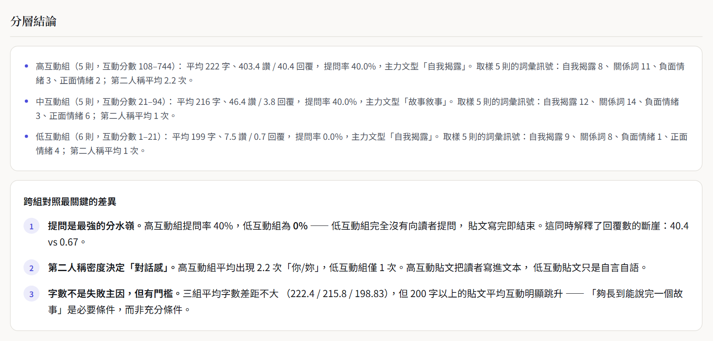

從上表的數字直接推導出三點，每一點都有對應的數據支撐：

### 1. 提問是最強的分水嶺

高互動組提問率 **40%**，低互動組 **0%**。
低互動組完全沒有向讀者提問，貼文寫完即結束。
這同時解釋了回覆數的斷崖：**40.4 vs 0.67**（相差約 60 倍）。

### 2. 第二人稱密度決定「對話感」

高互動組平均出現 **2.2 次**「你/妳」，低互動組僅 **1 次**。
高互動貼文把讀者寫進文本，低互動貼文只是自言自語。

### 3. 字數不是失敗主因，但有門檻

三組平均字數差距不大（222.4 / 215.8 / 198.83），
但 200 字以上的貼文平均互動明顯跳升 ——
「夠長到能說完一個故事」是**必要條件，而非充分條件**。

> 這三點的價值在於**可執行**：下一則貼文要不要加問句、有沒有寫到「你」，
> 是作者當下就能改的動作，而不是「多發文」這種無法執行的建議。

---

## 10. 常見關鍵字

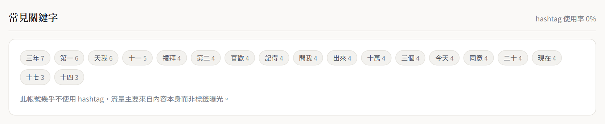

過濾停用詞後的高頻詞。採 bigram 近似切詞而非詞典式斷詞（如 jieba），
是為了讓專案**零安裝即可重現**（Python 端只用標準函式庫）。
代價是關鍵字可能含跨詞邊界的組合，這一點已在 README 的「已知限制」中載明。

---

## 11. 匯出

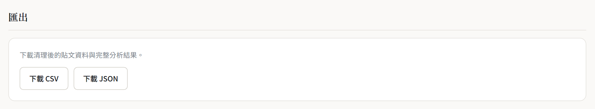

提供 CSV 與 JSON 下載（考題加分項），端點為 `/api/export?format=csv|json`。
匯出同樣受登入保護。

---

## 技術架構摘要

| 層 | 技術 | 說明 |
| --- | --- | --- |
| 前端 | Next.js 15 (App Router) + React 18 | Server Components，可部署至 Vercel |
| 圖表 | Recharts | 7 張互動式圖表 |
| 認證 | Supabase Auth | Email/Password + Magic Link |
| 資料庫 | Supabase Postgres | 4 張表，全部啟用 RLS |
| 資料管線 | Python 3.10+（純標準函式庫） | 清理 → 特徵萃取 → 分析 → 報告 |
| 測試 | unittest | 20 項單元測試 |

### 資料表與權限

| 資料表 | 用途 |
| --- | --- |
| `profiles` | 使用者資料，註冊時由 trigger 自動建立 |
| `analysis_jobs` | 分析任務（狀態、來源、筆數、錯誤訊息） |
| `posts` | 貼文資料，`unique(job_id, post_id)` 去重 |
| `analysis_results` | 彙總分析結果（JSONB） |

四張表全部 `enable row level security`，每條 policy 皆以 `auth.uid() = user_id` 為條件：
未登入者查詢回傳 0 筆，登入者**無法讀取其他使用者的資料**。

---

## 在本機重現這些畫面

```bash
git clone https://github.com/juliahahah/threads-analytics.git
cd threads-analytics
npm install
npm run data:build    # 產生 data/*.json 與 reports/
npm run dev           # http://localhost:3000
```

未設定 Supabase 時，登入頁會出現「以示範模式檢視 dashboard」入口，
可直接看到本文件所有畫面。詳細說明見 [README.md](../README.md)。
